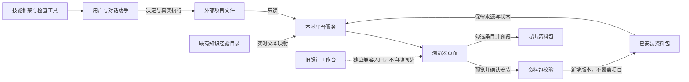

# 本体、项目与库

模块职责：

- `app.py`：CLI，外部示例数据初始化，选择配置与端口。
- `server.py`：加载绑定，读取项目，提供本机页面，项目下载白名单，管理接口边界。
- `library.py`：资料包格式与散列，目录挂载，安装不覆盖，选定导出。
- `web/`：显示真实记录，搜索和详情，安装/导出预览；不维护第二套任务完成状态。
- `skills/`：对话中的方法、角色契约与证据规则，不是网页后台执行器。

持久化以外部文件为准。只有资料包安装和运行状态写入data_root；页面不写总账、黑板、模型或原笔记。导出在内存形成JSON并由浏览器下载，不自动写入项目。程序没有遥测或模型网络调用。

当前没有事件总线、代理调度器、图数据库、数据库同步或外部工具执行层。重复读取文件提供映射更新，不把轮询称为实时智能编排。源码按模块分离，可替换适配器，但需要对兼容和证据语义做验证。
